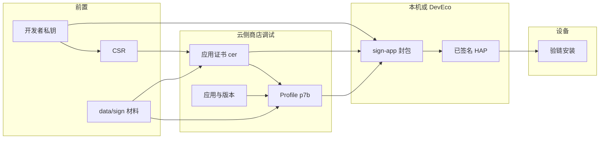
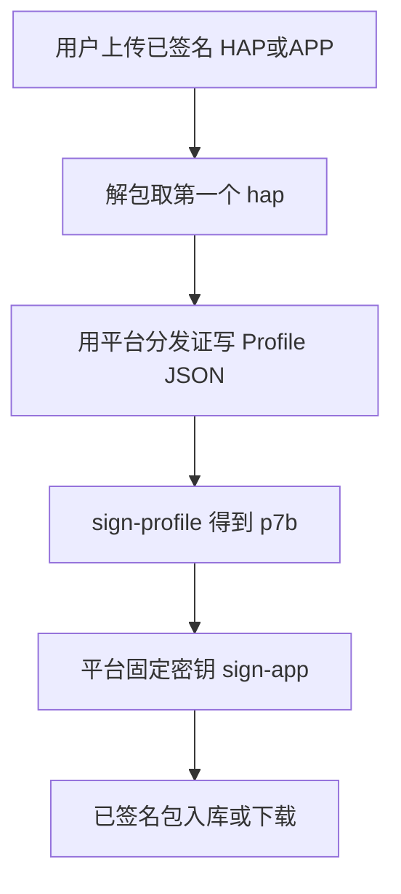

# 应用管理：证书、Profile 与封包安装流程

> 说明本仓与 hm-appstore 对齐的证书 / Profile / 封包业务。  
> 管理台入口已归入侧栏分组「应用管理」：
> - **证书**（`app_cert`）→ `/pages/apps/certs.html`，接口 `/platform/store/certs`
> - **我的应用**（`app`）→ 原应用仓库 + 应用详情内 **Profile**（`/platform/app/{id}/profiles`）
> 
> 旧「应用商店调试」页已跳转至证书；商店遗留应用表 `t_store_app*` 仍保留兼容，业务请用 `t_app_*` / `t_app_profile`。

---

## 1. 目标

让应用能在**信任指定证书体系的设备**上安装，需要齐备：

| 产物 | 作用 |
|------|------|
| 应用证书 `.cer` | 证明应用公钥身份（分发证书） |
| Profile `.p7b` | 授权：某包名可使用该分发证书、以何种级别分发 |
| 已签名 HAP/APP | 私钥签名 + 挂上证书与 Profile，设备验链通过后可安装 |

---

## 2. 两种封包模式

### 模式 1：平台出证，用户本地封包（证书提供方 + 包仓库）

1. 平台签发 / 托管应用证书、Profile，用户下载。  
2. 用户在 DevEco 或本地 `hap-sign-tool` 用**自己的私钥** + 证书 + Profile，封成已签名 HAP。  
3. 将已签名包装入应用仓库做分发。

此时平台**不参与签包**，只做：

- 证书 / Profile 材料提供  
- 安装包存档与分发  

### 模式 2：平台重签闭环（对齐 hm-appstore `hapResign`）

1. 用户上传一个（通常已签过的）HAP/APP。  
2. 平台解包，取出其中的 hap。  
3. 用**平台预置的同一套密钥与证书**（不是每个应用现生成私钥/CSR）生成 Profile，再 `sign-app` 重签。  
4. 将新的已签名包保存到应用市场。

业务原因：目标设备批次只信任企业/平台证书链，开发者原签名链对不上，必须换成平台链再签。

**要点纠正：**

- 模式 2 **不会**为每个应用独立生成私钥和 CSR。  
- 使用的是平台固定材料（例如配置中的平台分发证、`OpenHarmony.p12` 中的平台别名、`openvalley.pem` 等）。  
- 「解包」后是对 hap **重新签名**，得到平台信任链下的新包，不一定是还原成「从未签过」的工程态。

`hapResign` = 按模式 2：拆包 → 平台证书写 Profile → 平台密钥 `sign-app` → 产出可入库包。

---

## 3. 前置材料

签名机 / 本仓默认目录：`data/sign/`（可用环境变量 `MDM_STORE_SIGN_DIR`）。

| 文件 | 用途 |
|------|------|
| `hap-sign-tool.jar` | 官方签名工具（Profile / HAP） |
| `OpenHarmony.p12` | 密钥库（CSR 签发、Profile 签名；口令常见为 `123456`） |
| `OpenHarmonyProfileRelease.pem` | Profile 签名证书链 |
| `openvalley.pem` 等 | 平台应用证书（**模式 2 / hapResign** 需要；模式 1 调试 Profile 可不依赖） |

本机还需可用的 `java`、`keytool`。

公开调试材料可从 [openharmony/developtools_hapsigner](https://github.com/openharmony/developtools_hapsigner) 的 `dist/` 获取；与线上企业机材料不一定一致。

开发者侧（模式 1）还需：**私钥**（只留本机，不上云）及由其生成的 **CSR**。

---

## 4. 每一步实际做了什么、产物里有什么

下面按**时间顺序**说明：每一步输入什么、做了什么、输出文件里装了哪些信息。  
（以模式 1 为主；模式 2 在对应步骤注明差异。）

### 总览

| 顺序 | 产物 | 本质 | 一句话 |
|------|------|------|--------|
| ① | 私钥 + 口令（本机） | 密钥材料 | 真正「能签字」的东西，不上云 |
| ② | `.csr` | 证书申请 | 只有公钥 + 申请者信息，**没有私钥** |
| ③ | `.cer` | 应用证书（可含证书链） | CA 盖章：承认「这个公钥属于某某」 |
| ④ | 应用元数据 | 库表记录 | 包名、应用名等，还不是签名文件 |
| ⑤ | 未签名 Profile JSON | 授权草稿 | 写明包名、绑定哪张应用证、有效期等 |
| ⑥ | `.p7b` | 已签名 Profile | 草稿 + Profile CA 的签名，设备可验 |
| ⑦ | 已签名 `.hap` | 安装包 | 代码/资源 + 应用私钥签名 + 挂上 cer/p7b |

---

### ① 开发者私钥（模式 1）/ 平台私钥（模式 2）

**做什么：** 在本机（或平台签名机）生成或持有一对非对称密钥。

**文件形态：** 通常在 `.p12` / `.jks` 密钥库里，用「别名 + 密码」取出。

**里面有什么：**

| 信息 | 说明 |
|------|------|
| 私钥 | 签 HAP 时真正用来算签名的秘密 |
| 公钥 | 与私钥配对；会出现在 CSR / 证书里 |
| 别名、库口令、密钥口令 | 打开密钥库、使用私钥的凭证 |

**模式差异：**

- 模式 1：开发者自己创建，口令自己定。  
- 模式 2：平台共用一把（如 `OpenHarmony.p12` 里别名 `openvalley`，口令按配置）。

**不上云：** 私钥不应出现在「证书管理」下载物里。

---

### ② CSR（`.csr`，Certificate Signing Request）

**做什么：** 用私钥对「我是谁 + 我的公钥」做自签请求，提交给 CA 申请正式证书。

**里面有什么：**

| 信息 | 示例 / 说明 |
|------|-------------|
| Subject（申请者） | 如 `CN=Debug App, OU=MDM Debug, O=OpenValley, C=CN` |
| 公钥 | ECC P-256 等，与私钥配对 |
| 签名算法 | 如 SHA256withECDSA（证明持有对应私钥） |

**没有什么：** **没有私钥**，也不能当安装用证书；只是「请 CA 给我签一张 cer」。

本仓调试可用根目录 `debug-app.csr` 这类文件上传到「证书管理」。

---

### ③ 应用证书（`.cer`）——「第一张业务证书」

**做什么：** CA（`OpenHarmony Application CA`）用自己的私钥，对 CSR 里的公钥签发正式证书；本仓还会拼上中间 CA / Root，形成信任链文件。

**文件里通常有几段 PEM（链）：**

| 段序 | 是什么 | 关键信息 |
|------|--------|----------|
| 第 1 段（叶子） | **应用分发证书** | Subject（应用名等）、公钥、序列号、有效期、KeyUsage（如 Digital Signature）、由谁签发（issuer=Application CA） |
| 第 2 段 | Application CA（中间） | CA 自己的证书，证明叶子由它签发 |
| 第 3 段 | Root CA | 根证书，设备信任锚点之一 |

**叶子证书里「业务相关」的字段：**

| 字段 | 含义 |
|------|------|
| Subject | 证书主体（调试名、组织等），**不是** HAP 包名 |
| Public Key | 与开发者/平台私钥对应的公钥 |
| Issuer | OpenHarmony Application CA |
| Serial / 有效期 | 每次签发可变；同一 CSR 两次签发会不同 |
| Key Usage | 一般含数字签名，用于应用签名场景 |

**库里另存的 `app_cert`：** 往往只存**第 1 段叶子 PEM**，后面写 Profile 的 `distribution-certificate` 用这一段。

**模式差异：**

- 模式 1：这张 cer = 开发者身份（对应开发者私钥）。  
- 模式 2：平台用固定的 **`openvalley.pem`（≈ 这张叶子证的角色）**，不再为每个应用走 CSR→cer；p12 里已有对应私钥。

---

### ④ 应用 / 版本（商店里的「应用管理」）

**做什么：** 登记「要发哪个应用、哪个版本」，可选上传安装包文件做仓库。

**里面有什么（元数据，不是证书）：**

| 信息 | 说明 |
|------|------|
| 应用名 | 展示用 |
| **包名 bundleName** | 必须与 HAP 内一致；后面写进 Profile |
| 描述、图标 | 可选 |
| 版本名 / versionCode | 版本维度 |
| 安装包文件 | 模式 1 下常为存档；模式 2 下作为待重签输入 |

**还没有：** 签名、Profile、设备安装授权——那些在后面步骤。

---

### ⑤ 未签名 Profile JSON（中间草稿，一般不长期给用户）

**做什么：** 按应用 + 所选应用证书，拼一份「授权声明」JSON，再拿去签成 p7b。

**里面有什么（本仓 / hm-appstore 对齐的主要字段）：**

| 字段 | 含义 |
|------|------|
| `bundle-name` | 允许安装的应用包名 |
| `distribution-certificate` | 嵌入的**应用叶子证书 PEM**（步骤 ③） |
| `version-code` / `version-name` | Profile 自身版本信息（常有默认值） |
| `type` | 如 `release` |
| `app-distribution-type` | 如 `os_integration` |
| `developer-id` | 如 `OpenHarmony` |
| `apl` / `app-feature` | 如 `normal` / `hos_normal_app` |
| `issuer` | Profile 文案上的颁发者字符串 |
| `validity` | not-before / not-after（Unix 时间） |
| `uuid` | 每次生成 Profile 新开一个 |

**没有什么：** 还没有 Profile CA 的签名；设备一般不直接认这份裸 JSON。

---

### ⑥ Profile（`.p7b`）——「第二张 / 第二类证书材料」

**做什么：** 用 Profile 专用密钥对上面的 JSON 做 `sign-profile`，得到 PKCS#7 签名包。

**里面有什么：**

| 部分 | 内容 |
|------|------|
| 被签名内容 | 步骤 ⑤ 的整份 provision（含包名、嵌入的应用 cer 等） |
| 签名值 | Profile Release 私钥算出的签名 |
| 附带的证书链 | 如 OpenHarmony Application Profile Release → Application CA → Root |

可用 `hap-sign-tool verify-profile` 验：通过则会解析出与 JSON 相同的业务字段。

**和步骤 ③ 的 cer 有何不同：**

| | `.cer`（应用证书） | `.p7b`（Profile） |
|--|-------------------|-------------------|
| 回答的问题 | 「这把公钥是谁的？」 | 「这个包名能不能用这张应用证装/分发？」 |
| 谁签的 | Application CA | Profile Release 密钥 |
| 是否含包名 | 通常不含 | **含 `bundle-name`** |
| 是否嵌应用证 | 自己就是应用证 | **内嵌** `distribution-certificate` |

---

### ⑦ 已签名 HAP（封包结果）

**做什么：** `sign-app`：用**应用私钥**对 hap 内容签名，并关联应用证书 + Profile。

**命令上挂上的三件套：**

| 参数 | 模式 1 | 模式 2 |
|------|--------|--------|
| 私钥（keystore + alias + 密码） | 开发者自己的 | 平台 `openvalley` 等 |
| `-appCertFile` | 步骤 ③ 的 `.cer` / 叶子 | `openvalley.pem` |
| `-profileFile` | 步骤 ⑥ 的 `.p7b` | 平台现场生成的 p7b |

**包内相对用户可见的「效果」：**  
设备安装时能同时验：应用签名、Profile 签名、包名与分发证是否一致、是否落在信任根上。

---

### 串起来记

1. **私钥**：能签字（秘密）。  
2. **CSR**：拿公钥去申请。  
3. **cer**：CA 承认公钥（应用身份）。  
4. **应用记录**：登记包名。  
5. **Profile JSON**：声明「此包名 + 此 cer」。  
6. **p7b**：给这份声明盖 Profile CA 章。  
7. **已签名 HAP**：用私钥签字，并带上 cer + p7b，才能在信任该链的设备上装。

---

## 5. 完整链路（模式 1 逐步说明）



### 步骤 0：环境就绪

- `java` / `keytool` 可用  
- `data/sign/` 材料齐全  
- 管理台「应用商店调试」显示 CSR / Profile 工具就绪  

### 步骤 1：证书管理（应用证书）

**目的：** 得到应用发布证书 `.cer`。

**方式 A — 上传 CSR（对齐 hm-appstore 证书新增）**

1. 本机用密钥生成 CSR。  
2. 管理台「证书管理」上传 `.csr`。  
3. 云侧 `keytool -gencert`（`OpenHarmony.p12` 中 Application CA）签发叶子。  
4. 保留 keytool 输出（通常含叶子 + 中间 CA），再追加 Root，形成完整链。  
5. 落库：文件存完整 `.cer`；业务字段 `app_cert` 存**叶子 PEM**（供写 Profile）。

**方式 B — 直接上传已有 `.cer` / `.pem`**

- 解析第一段叶子 PEM 入库，文件原样保存。

### 步骤 2：应用管理（元数据 + 包存档）

1. 新建应用：名称 + **包名 bundleName**（须与 HAP 内 `module.json` / `config.json` 一致）+ 描述。  
2. 上传版本：版本名、versionCode、安装包（`.hap` / `.app` / `.sap`）。  
   - 本仓当前：版本上传为**存档**，不自动重签。

### 步骤 3：生成 Profile（`.p7b`）

1. 选择应用与已解析 PEM 的证书。  
2. 云侧组装 provision JSON（含 `bundle-name`、`distribution-certificate` 叶子 PEM、`type`、`apl`、`validity`、`uuid` 等）。  
3. `hap-sign-tool sign-profile`（Profile Release 密钥 + `OpenHarmonyProfileRelease.pem`）。  
4. 产出 `.p7b`，可下载。

同一 CSR 两次签发的 cer、或两次生成的 p7b：序列号 / uuid / 时效可能不同，但**公钥与信任链一致时，装机效果等价**。

### 步骤 4：本机封包（模式 1）

```text
java -jar hap-sign-tool.jar sign-app
  -keyAlias       <应用密钥别名>
  -keystoreFile   <含应用私钥的 p12/jks>
  -keyPwd / -keystorePwd
  -appCertFile    <步骤1的 cer 或叶子 PEM>
  -profileFile    <步骤3的 p7b>
  -inFile         <未签名或待重签 hap>
  -outFile        <已签名 hap>
```

或在 DevEco 中选择上述证书与 Profile 签名。

### 步骤 5：设备安装校验（概念）

1. HAP 签名能否被证书链验证。  
2. Profile 是否由信任的 Profile CA 签发且有效。  
3. Profile 中 `bundle-name` 与应用一致。  
4. Profile 中分发证书与签名用证匹配。

---

## 6. 模式 2 / hapResign 流程



与模式 1 的「Profile → sign-app」步骤同类，差别是：

- 密钥 / 应用证书来自**平台固定材料**，不是用户下载后自签。  
- 由云侧一次做完，用户不必在 DevEco 里操作。

本仓已在「我的应用 · 版本」接通 hapResign：需 `openvalley.pem`（或 `MDM_STORE_APP_CERT_FILE`）及 `OpenHarmony.p12` 中对应别名（默认 `openvalley`）。

---

## 7. 模式对比

| 项目 | 模式 1 | 模式 2（hapResign） |
|------|--------|---------------------|
| 谁持有应用私钥 | 开发者 | 平台（预置） |
| 是否每应用生成 CSR | 开发者按需申请证书时生成 | 否，共用平台密钥 |
| 平台职责 | 出证 + 包仓库 | 解包 + 重签 + 入库 |
| 典型工具 | DevEco / 本地 hap-sign-tool | 云侧 hap-sign-tool 子进程 |
| 适配设备批次 | 取决于用户使用的证书是否被设备信任 | 使用平台证书，适配信任该平台链的设备 |

---

## 8. 本仓「应用商店调试」现状

入口：`/pages/store/index.html`，接口前缀：`/platform/store`。

| 能力 | 状态 |
|------|------|
| 签名工具状态 `/sign-status` | 已实现 |
| 证书 CSR→cer / 上传 cer | 已实现 |
| 应用 / 版本 CRUD（版本存档） | 已实现 |
| Profile 生成 p7b | 已实现 |
| hapResign 云侧重签 | **已接通**：`POST /platform/app/{id}/versions/{vid}/resign`；上传包可带 `?resign=true` |

签名材料说明见：`data/sign/README.md`。

---

## 9. 与「应用管理」模块的边界

| | 应用商店调试 | 应用管理 |
|--|--------------|----------|
| 路径 | `/pages/store` | `/pages/apps` |
| 数据表 | `t_store_*` | `t_app_*` |
| 用途 | 证书 / Profile / 签名调试 | MDM 策略安装卸载用的应用仓库 |

模式 1 下，用户也可将本地签好的包上传到「应用管理」做 MDM 分发；两套仓库是否打通属产品选择，当前代码默认独立。

---

## 10. 推荐调试顺序（模式 1）

1. 确认 `data/sign/` 与 Java 就绪。  
2. 本机生成密钥与 CSR → 证书管理上传签发 → 下载 `.cer`。  
3. 新建应用（包名与真实 HAP 一致）→ 可选上传版本存档。  
4. 生成并下载 Profile `.p7b`。  
5. DevEco / 命令行用私钥 + cer + p7b 签名。  
6. 在信任对应 CA 的设备上安装验证。

---

## 11. 相关代码位置（本仓）

| 模块 | 路径 |
|------|------|
| API | `app/api/store.py` |
| 业务 | `app/services/store_service.py` |
| 签名封装 | `app/services/store_sign.py` |
| 前端 | `web/pages/store/index.html`、`web/assets/js/pages/store.js` |
| 配置 | `app/config.py` 中 `MDM_STORE_*` |

对照上游：`D:\gerrit\hm-appstore` 中 `CertServiceImpl`、`InfoProfileServiceImpl`、`HapServiceImpl#hapResign`。
